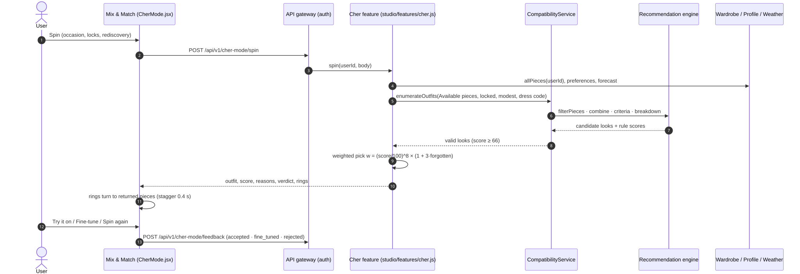

# Closet v3.0 — Studio features (final milestone)

Addendum to the SRS v2.0, the SDD v2.0 and the Test Plan & Report v2.0. Build v3.0 · Team Closet · CSCE 3701.

## 1. What changed in v3.0

Nine new features, called **Studio**. They are built on the existing modules and do not change older features.

- **One scorer.** Every feature scores outfits through one `CompatibilityService` (`server/src/modules/studio/compatibility.js`). It wraps the existing recommendation engine, so a look gets the same score in Style me, Mix & Match and every Studio feature. No feature has its own scoring.
- **Own clothes only.** Features use the user's own pieces, plus friends' pieces only when the friend chose to share them. Looks use **Available** pieces and respect the *modest-only* setting and the dress-code levels.
- **Numbers come from our code.** Outfit counts, percentages, scores and statistics are always calculated by Closet. A language model may only (a) read a photo or text into fixed fields, or (b) write one sentence from numbers we already calculated. A validator rejects any answer that contains a number we did not calculate.
- **Strict JSON for every AI call** (`claudeJson.js`):
  - The answer must use a fixed tool schema and is checked against that schema.
  - Every garment id must be in the allowed set, so the model cannot invent a piece or return someone else's piece.
  - A bad answer gets **one retry**. After that, the feature uses its friendly rule-based fallback.
  - So every feature also works with **no AI key** (keyword parsing or manual choice).
- **Authorization on the server.** Every Studio route is behind the login token. Pieces that belong to someone else return **404**. Friends' closet returns **403** to anyone who is not a confirmed friend.
- **Feature flags.** `FEATURES_OFF=mood,wrapped` turns single features off; their routes then answer `404 FEATURE_OFF`. `GET /api/v1/studio/features` lists the flags.
- **One module, one file per feature** (`server/src/modules/studio/features/*.js`). One route table serves both the Express server and the offline demo, so the two cannot drift apart.

## 2. Requirements and user stories (Jira-ready)

Story points use the team's scale. All ten stories belong to **Sprint 4 (final milestone)**.

### US-120 Should I buy this? (+ What if I donate this?) — 5 pts
*As a user, I want to see how many complete outfits a new piece would add before I buy it, so that I only buy what I will actually wear.*

1. Given a photo (AI fills in the details) or a manual category, colour and dress codes, the app shows my outfit count **before and after**, in total and per occasion.
2. The verdict is **Buy** (≥ 3 new outfits), **Think about it** (1–2) or **Skip** (0, or I already own almost the same piece). The similar pieces I own are shown.
3. The calculation runs on a copy of my closet. Nothing is saved, and my piece count does not change.
4. *What if I donate this?* shows how many outfits I would lose, and which pieces would become hard to style.
5. Someone else's piece returns 404. A missing category or colour returns 400.

### US-121 Cher mode (spin for me) — 8 pts
*As a user, I want Closet to spin my wardrobe like in Clueless and land on a look, so that getting dressed feels fun and quick.*

1. *Spin for me* returns an outfit made only of my own **Available** pieces. The three rings land exactly on the returned pieces, and stop one after another.
2. The server picks the look **before** the animation, using weighted random sampling: `w = (score/100)^8`. High-score looks are picked far more often.
3. Locked pieces never change between spins.
4. With **Rediscovery** on, each weight is multiplied by `1 + 3 × forgotten pieces`, and forgotten pieces get a *Rediscovered* badge.
5. Match or mismatch (match when the score is ≥ 75), the score and the reasons come from CompatibilityService. *Try it on* opens the existing Virtual Try-On. *Fine-tune* opens *Build it myself* with the look preloaded. Each action is logged with `/cher-mode/feedback`.

### US-122 Emergency rescue — 5 pts
*As a user, I want to type what went wrong (“coffee on my shirt”) and get the smallest change that saves my outfit.*

1. The app understands stains, damage, *too formal* / *too casual*, and *too cold* / *too hot*, using AI or keywords.
2. The fix changes the **fewest pieces** (1, then 2 …) and still passes the rules (score ≥ 83).
3. The affected piece is never part of the fix.
4. Optionally, the stained piece moves to Laundry, or the broken piece moves to Needs repair, through the normal status flow.
5. I can wear the fix, or fine-tune it in Mix & Match.

### US-123 Invitation decoder — 5 pts
*As a user, I want to snap or paste an invitation and get the event in my planner with outfits for that day.*

1. The title, date, time and dress code (1–5) are read by AI from a photo or text. Without AI, keywords are used (“black tie” → Formal, “cocktail” → Semi-formal …).
2. Every field is shown in an editable card before anything is saved.
3. *Confirm* creates the Planner event. I then get up to 3 looks for that dress code and that day's forecast.
4. A missing date blocks saving, with a clear message.

### US-124 Mood styling — 3 pts
*As a user, I want to pick how I feel (confident, cozy, bold, calm, playful, elegant) and get three looks for that mood.*

1. Each mood ranks valid looks by styles, colours and fabrics. It never lowers the rule threshold: every look still scores ≥ 83.
2. The three looks are different (the same diversity rule as Style me), and each one shows its mood fit and its reasons.
3. *One piece, every mood* shows one locked piece styled in each mood.
4. An unknown mood returns 400.

### US-125 Recreate this look — 5 pts
*As a user, I want to upload an inspiration photo and find the closest pieces I own.*

1. AI describes the pieces in the photo. Without AI, I type a description.
2. Each piece is matched to my closet as **Exact** (≥ 90 %), **Close** (≥ 60 %), **Alternative** or **Missing**. The same category is required.
3. Missing pieces can go to my shopping list, or be requested from a friend who lends a matching piece.
4. The matched pieces are scored as one look.

### US-126 Fit check — 3 pts
*As a user, I want to take a mirror selfie and get a score and one swap before I leave.*

1. AI matches the photo only to my own Available pieces (ids are checked). Without AI, I pick the pieces myself.
2. I see the score, the reasons and **one best swap**, with its new score.
3. *Save my outfit* runs the normal wear flow: wear count, last worn and analytics.
4. The photo is never stored.

### US-128 Closet wrapped — 3 pts
*As a user, I want a fun recap of my style for the last 30 / 90 / 365 days that I can share.*

1. The cards show outfits worn, different pieces, rotation %, my most-worn piece, my top colours %, my top occasion, my favourite formula, forgotten pieces and closet health. All of these are counted from my wear history.
2. My persona comes from my top style. AI may only write a tagline, with no numbers.
3. *Download share card* draws a PNG in the browser. No extra library is used.
4. Any period other than 30, 90 or 365 days returns 400.

### US-129 Friends' closet — 8 pts (security-critical)
*As a user, I want to request access to a friend's closet with her Closet email, see everything she owns once she agrees, and ask to borrow a piece.*

1. *Request access* takes a Closet email. The friend sees **"Habiba requested access to your closet"** in her Notification Center and on the Requests tab. The reply is the same whether or not the email exists, so accounts cannot be discovered.
2. *Give access* makes the friendship mutual: both users can open the other's **whole closet**. They see the photo, name, category, colour and whether each piece is available — never wear history, notes or prices.
3. Anyone who is not a confirmed friend gets **403**. A pending request is not enough.
4. *Ask to borrow* works only on an Available piece (otherwise 409). The owner is notified and approves or declines; only the owner can decide. *Approve* runs the existing Borrow & lend flow, so the piece becomes Borrowed and shows as unavailable. The requester is notified of the answer.
5. Removing access ends it for both users. Friend actions are written to the activity log without garment details.

## 3. API (all under `/api/v1`, login token required)

| Method | Path | Feature | Body / query | Response (main fields) |
|---|---|---|---|---|
| GET | /studio/features | all | – | `features{buy…friends}`, `ai` |
| POST | /studio/buy/check | Buy | `piece{category, colour, dressCodes, styles, name}` or `photo{base64, mime}` | `verdict, sentence, before, after, gain, byOccasion[], similar[], examples[]` |
| POST | /studio/buy/donate | Buy | `itemId` | `verdict, before, after, lost, byOccasion[], hardToStyle[]` |
| POST | /cher-mode/spin (also /studio/cher-mode/spin) | Cher | `lockedGarmentIds{top, bottom, shoes}, rediscovery, occasion` | `outfit{top, bottom, shoes}` (each piece has `id, name, thumbnailUrl, isForgotten`), `score, compatibility, reasons[], verdict, forgottenCount, rings{}` |
| POST | /cher-mode/feedback | Cher | `garmentIds[], score, action: accepted · rejected · fine_tuned` | `stored` |
| POST | /studio/rescue | Rescue | `itemIds[], problem, occasion, apply` | `problem, affected[], marked[], fix{itemIds, score, changed, swaps[]}` |
| POST | /studio/invitation/decode | Invitation | `text` or `photo` | `source, card{title, date, time, dressCodeLevel, occasion}` |
| POST | /studio/invitation/confirm | Invitation | `card` | `event, weather, looks[]` |
| GET / POST | /studio/mood | Mood | `mood, occasion` | `looks[]` (each look has `moodFit` and `moodReasons`) |
| POST | /studio/mood/restyle | Mood | `itemId, occasion?` | `moods[]` (one look per mood) |
| POST | /studio/recreate | Recreate | `text` or `photo` or `pieces[]` | `matches[]` (each match has `level` and `friend`), `itemIds, score, summary` |
| POST | /studio/recreate/shopping-list | Recreate | `target` | shopping list item |
| POST | /studio/fit-check | Fit check | `itemIds[]` or `photo`, `occasion` | `detected[], score, compatibility, reasons, swap` |
| POST | /studio/fit-check/save | Fit check | `itemIds[]` | `saved` |
| GET | /studio/wrapped?days=30\|90\|365 | Wrapped | – | `outfitsWorn, differentPieces, rotation, mostWorn, topColours[], persona, tagline …` |
| GET / POST | /studio/friends | Friends | `email` (request access) | `friends[], incoming[], outgoing[]` |
| POST / DELETE | /studio/friends/:id/accept · /studio/friends/:id | Friends | – | `accepted` · `removed` |
| GET | /studio/friends/:friendId/closet | Friends | – | `items[]` (whole closet, safe fields + `available`) · **403** if not a friend |
| POST | /studio/friends/borrow | Friends | `friendId, itemId` | `request{id, status}` |
| GET / POST | /studio/friends/requests · /studio/friends/requests/:id | Friends | `decision: approve · decline` | `requests[]` · `status` |

**Example** — `POST /api/v1/cher-mode/spin {"occasion":"Everyday","rediscovery":true,"lockedGarmentIds":{}}` returns:
`{"outfit":{"top":{"id":"…","name":"Breton striped top","thumbnailUrl":"…","isForgotten":false},"bottom":{…"Black midi skirt"…},"shoes":{…"Black loafers"…}},"score":100,"compatibility":97,"verdict":"match","reasons":["Complete outfit: top or dress, bottom, shoes","Colour harmony: all neutral colours",…],"forgottenCount":0}`.

## 4. Data model — migration 009 (`server/migrations/009_studio_v3.sql`)

There is one new schema, `studio`. Every table references `accounts.users ON DELETE CASCADE`, so deleting an account (US-06) also removes these rows.

| Table | Purpose | Key columns |
|---|---|---|
| studio.friendships | mutual friendship | requester_id, addressee_id, status pending · accepted; unique per pair (LEAST/GREATEST index) |
| studio.borrow_requests | borrow requests and their decisions | item_id, owner_id, requester_id, status pending · approved · declined |
| studio.cher_feedback | what the user did with a spun look | user_id, item_ids, score, action |

Accepted Cher looks are also saved as favourites. Rejected looks become a reject signal. Both feed the existing learned style patterns.

## 5. Design (SDD additions)

**Class diagram — Studio module.** One module registers nine feature objects. All the features that score looks depend on CompatibilityService. All the features that call AI go through `callClaudeJSON`.

**Sequence diagram — Cher mode spin (outfit generation).** The random pick happens on the server, before the animation.

**Front end.**

- New screens live in `client/src/screens/studio/*.jsx`. Cher mode is `client/src/screens/CherMode.jsx`, shown inside Mix & Match.
- Cher mode uses CSS 3D rings: `perspective`, `preserve-3d`, and each card placed with `rotateY(i·360/n) translateZ(r)`. The final angle is `−(i·360/n) − turns·360`.
- It respects `prefers-reduced-motion`, uses an `aria-live` verdict and has an optional voice (`speechSynthesis`, inside try/catch).
- The share card in Closet wrapped is drawn on a canvas, so no new npm dependency is needed.

## 6. Test report (v3.0)

| Suite | Where it runs | Result |
|---|---|---|
| Unit tests, all suites (incl. new `studio.test.js`, ST-01…ST-19) | locally | **453 / 453 passed** (security.test.js runs on CI) |
| `studio.test.js` (CompatibilityService, strict JSON + retry, weighted sampling, rediscovery, keyword fallbacks, flags, all 10 features on the offline demo, friends 403) | locally | 19 / 19 |
| `tests/api/studio_api.test.js` (API-ST01…ST18) | CI (PostgreSQL) | written; at least one test per endpoint, including 401 / 403 / 404 |
| Migration 009 and repository SQL checked on PostgreSQL 16 | locally | passed (a duplicate friend pair is rejected) |
| UI check of every new screen in the offline build (Playwright) | locally | no page errors |

**Key test cases.**

- **ST-08:** over 2000 spins, the score-100 look is picked more than 90 % of the time.
- **ST-09:** rediscovery makes looks with forgotten pieces more than 3× more frequent.
- **ST-05:** an invented garment id is rejected, retried once, and then the feature falls back.
- **API-ST05:** a user never receives another user's garments, even in the rings.
- **API-ST14–ST18:** the Friends' closet security rules.

**Not done / limits (honest).**

- Cher mode **Phase 2** (React Three Fiber 3D scene) was not built. It needs three new npm packages, and the package registry was not reachable from our build machine. Phase 1 (CSS 3D) covers every acceptance criterion.
- Thumbnails use the existing photo URLs. There is no separate 256 px resize yet.
- The AI paths are covered by tests with a fake model. The live Anthropic model was not called in CI.

## 7. Live demo scripts (about 2 minutes each)

**Cher mode (90 s).**

1. Mix & Match → *Spin for me*.
2. Spin, and point out that the three rails stop one after another.
3. If the result is a mismatch, read the reasons, then *Spin again*.
4. On a match: “the server chose this before the animation, and the score is from our rules.”
5. *Lock* the top, then spin again. The top stays.
6. Turn on *Rediscovery* and spin. Point out the *Rediscovered* badge.
7. *Try it on* opens Virtual Try-On. Go back, then *Fine-tune* opens *Build it myself* with the look loaded.

**Should I buy this?**

1. Choose Bottom · Navy · Business casual + Semi-formal, then *Check it*.
2. Show *before → after* per occasion and the verdict.
3. Change the colour to Black: the verdict becomes *Skip*, because I already own black tailored trousers.
4. Switch to *What if I donate this?*, pick the navy blazer, and show the outfits lost.

**Emergency rescue.** Choose ivory blouse + black trousers + loafers, type “I spilled coffee on my shirt”, then *Rescue me*. One piece changes, the score stays ≥ 83, and the blouse moves to Laundry. Then *Wear the fix*.

**Invitation decoder.** Paste “Wedding … 12 December at 7:30 pm. Dress code: black tie.” The card shows Formal. Edit the time, then *Add to planner & style me*. Show the 3 looks and the weather, then *Plan this look*.

**Mood styling.** Choose *Cozy* + University: three knit / neutral looks, each with its mood reasons. Switch to *One piece, every mood*, pick the black blazer, and show six moods.

**Recreate this look.** Type “black blazer, white shirt, blue jeans, silver heels”. Show the Exact / Close / Alternative levels, add the missing piece to the shopping list, and show that Nour can lend silver heels.

**Fit check.** Use *Pick pieces instead*: Breton top, beige trousers, white sneakers. Show the score and one swap, then *Save my outfit* (the wear count goes up).

**Closet wrapped.** Swipe through the cards (30 days → 90 days), then *Download share card*.

**Friends' closet (two accounts).**

1. As Habiba (`demo@closet.app`), go to Friends' closet → *Request access* → `nour.demo@closet.app`.
2. Sign out and sign in as Nour (`nour.demo@closet.app` / `Closet2026!`). The bell shows "Habiba requested access to your closet". Open Requests → *Give access*.
3. Sign in as Habiba again. The bell shows "Nour gave you access". *Open closet* shows all 10 of Nour's pieces → *Ask to borrow* the red clutch.
4. Sign in as Nour. "Habiba asks to borrow your red clutch" → *Approve*. The clutch moves to Borrow & lend.
5. Sign in as Habiba. "Nour approved your request". In Nour's closet, the clutch now shows as not available.

## 8. Change log

| Version | Date | Change |
|---|---|---|
| 3.1 | 26 Nov 2026 | Stylist battle removed. Friends' closet reworked: access by Closet email, the whole closet visible to friends, Notification Center entries for requests and answers, a second demo account (Nour). New colour palette (ivory, cashmere, warm oak, brass, burgundy, espresso). |
| 3.0 | 25 Nov 2026 | Studio: 10 features, CompatibilityService, strict-JSON AI gate, migration 009, Friends' closet, Cher mode (CSS 3D), 19 unit + 18 API tests, demo seed (Nour + 4 lendable pieces) |

## 9. Future expansion

1. **Cher mode Phase 2:** a React Three Fiber scene behind a *3D view* toggle, falling back to CSS 3D when WebGL is not available.
2. **Closet X-Ray:** a heat map showing which pieces carry the most outfits (this needs only the CompatibilityService counts).
3. **Friends' group events:** coordinate colours for a group invitation, using the Invitation decoder and Friends' closet together.
4. **Push notifications** for borrow requests (through the Notification Service adapter).
